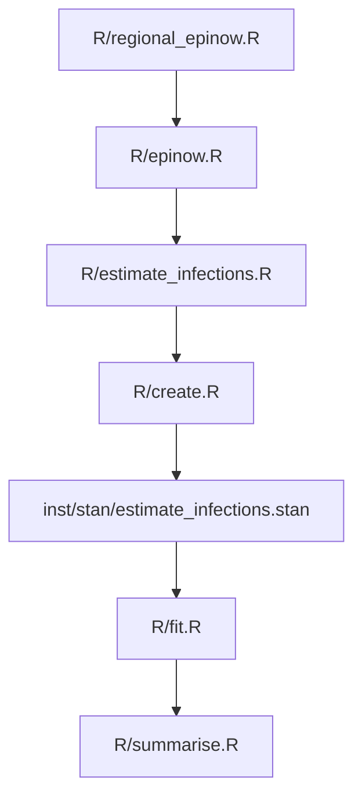

# epiforecasts/EpiNow2

> Bayesian R package that estimates the reproduction number Rt in real time and forecasts cases.

## The problem
Naive Rt estimates ignore reporting delays and uncertainty.

## What it actually does
`epinow()` and `regional_epinow()` call `estimate_infections()`, which prepares the data and runs a Gaussian-process Stan model (MCMC by default). It propagates delay uncertainty and forecasts infections and cases. `estimate_secondary()` and `estimate_truncation()` complete it. Variational inference, Pathfinder and Laplace via `cmdstanr`.

## How it is wired
Diagram based on the code diagram.



## Trying it
```bash
# Dans R :
# install.packages("EpiNow2")
# vignette("EpiNow2")
```

## Cost and gotchas
Free. Stan compilation: a C++ toolchain (RTools on Windows) is required. MCMC computations can be long. License: MIT badge, but not identified by GitHub.

## What it is not
Not a turnkey tool: it assumes knowledge of epidemiology and Bayesian models.

## Alternatives
- `{EpiEstim}`: similar approach for Rt.
- `{epinowcast}`: more flexibility for nowcasts.

## For you
Keep an eye on it: a polished example of Bayesian Stan modeling in R for time series, useful if you do epidemiology or forecasting.
