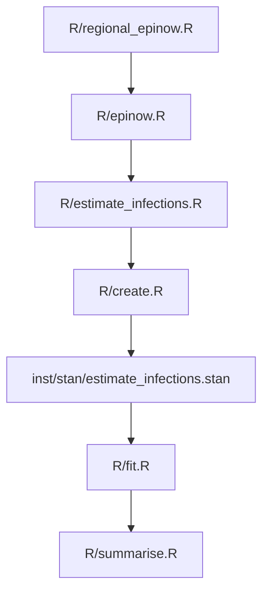

# epiforecasts/EpiNow2

> Paquet R bayésien qui estime en temps réel le nombre de reproduction Rt et prévoit les cas.

## Le problème
Les estimations naïves de Rt ignorent les retards de déclaration et l'incertitude.

## Ce que ça fait vraiment
`epinow()` et `regional_epinow()` appellent `estimate_infections()`, qui prépare les données et lance un modèle Stan à processus gaussien (MCMC par défaut). Il propage l'incertitude des délais et prévoit infections et cas. `estimate_secondary()` et `estimate_truncation()` complètent. Inférence variationnelle, Pathfinder et Laplace via `cmdstanr`.

## Comment c'est branché
Schéma d'après le diagramme du code.



## Essayer
```bash
# Dans R :
# install.packages("EpiNow2")
# vignette("EpiNow2")
```

## Coût et pièges
Gratuit. Compilation Stan : toolchain C++ (RTools sous Windows) nécessaire. Les calculs MCMC peuvent être longs. Licence : badge MIT, mais non identifiée par GitHub.

## Ce que ce n'est pas
Pas un outil clé en main : il suppose des notions d'épidémiologie et de modèles bayésiens.

## Alternatives
- `{EpiEstim}` : approche similaire pour Rt.
- `{epinowcast}` : plus de flexibilité pour les nowcasts.

## Pour toi
Surveiller : exemple soigné de modélisation bayésienne Stan en R pour séries temporelles, utile si tu fais de l'épidémiologie ou de la prévision.

