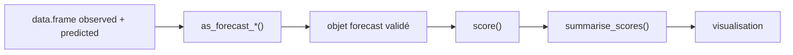

# epiforecasts/scoringutils

> Package R pour évaluer des prévisions (binaires, ponctuelles, quantiles, échantillons) avec des règles de score, pour modélisateurs.

## Le problème
Comparer des modèles de prévision demande des métriques propres à chaque type de prévision, et un format de données rigoureux. Sans cadre commun, chacun recode ses scores.

## Ce que ça fait vraiment
Valide un data.frame et le convertit en objet « forecast » (binary, point, quantile, sample, nominal), puis calcule des scores par défaut selon le type. Les scores se résument par groupe avec `summarise_scores()`. On peut ajouter ses propres règles de score. Des fonctions de visualisation et de gestion des prévisions manquantes sont annoncées.

## Comment c'est branché
Schéma simplifié d'après la fiche, sans diagramme fourni.



## Essayer
```bash
# dans R
install.packages("scoringutils")
remotes::install_github("epiforecasts/scoringutils", dependencies = TRUE)
```

## Coût et pièges
Gratuit, mais il faut R. Le format d'entrée est strict : les colonnes en trop brouillent l'unité de prévision, d'où l'argument `forecast_unit`.

## Ce que ce n'est pas
Ce n'est pas un outil de prévision : il note des prévisions déjà produites. Il n'est pas disponible en Python. La licence est présente mais GitHub ne l'identifie pas.

## Alternatives
- scoringRules : cité dans le README pour le CRPS, le DSS et le Log Score (à citer aussi si utilisés).

## Pour toi
À surveiller : utile si tu évalues des prévisions probabilistes en R, sinon sans objet dans une pile Python, et la licence reste à vérifier avant tout usage commercial.

