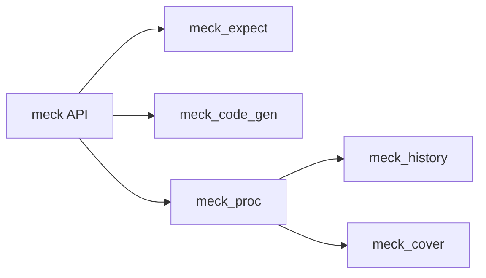

# eproxus/meck

> Mocking library for Erlang modules, for writing unit tests.

## The problem
Testing Erlang code that calls other modules without actually running those modules.

## What it actually does
- Creates a mock of an existing or non-existent module (`non_strict` option).
- Defines dynamic expectations (`expect`) with varying return values, deliberate exceptions and passthrough to the original (`passthrough`).
- Keeps the full history of calls and waits for specific calls.
- Saves and restores coverage data; mocks unload if the creating process crashes.

## How it is wired


## Trying it
```bash
rebar3 compile
rebar3 eunit
rebar3 edoc
```
```erlang
1> meck:new(dog, [non_strict]).
2> meck:expect(dog, bark, fun() -> "Woof!" end).
```

## Cost and gotchas
Free. The mock recompiles and reloads the module across the whole VM: some modules cannot be mocked (`erlang`, `supervisor`, `gen_*`, `crypto`…). A local call within the module is not intercepted. Under Common Test, use `no_link`.

## What it is not
Not a complete testing framework. The README does not cover Elixir in detail.

## Alternatives
No alternative named in the README.

## For you
Ignore: Erlang testing tool, no data / AI use.
