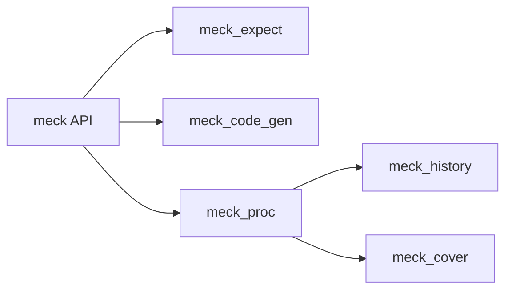

# eproxus/meck

> Bibliothèque de simulation (mock) de modules Erlang, pour écrire des tests unitaires.

## Le problème
Tester du code Erlang qui appelle d'autres modules sans exécuter ces modules pour de vrai.

## Ce que ça fait vraiment
- Crée un mock d'un module existant ou inexistant (option `non_strict`).
- Définit des attentes dynamiques (`expect`) avec retours variables, exceptions voulues et passage vers l'original (`passthrough`).
- Garde l'historique complet des appels et attend des appels précis.
- Sauvegarde et restaure les données de couverture ; les mocks se déchargent si le processus créateur plante.

## Comment c'est branché


## Essayer
```bash
rebar3 compile
rebar3 eunit
rebar3 edoc
```
```erlang
1> meck:new(dog, [non_strict]).
2> meck:expect(dog, bark, fun() -> "Woof!" end).
```

## Coût et pièges
Gratuit. Le mock recompile et recharge le module dans tout le VM : certains modules ne se simulent pas (`erlang`, `supervisor`, `gen_*`, `crypto`…). Un appel local au module n'est pas intercepté. Sous Common Test, utiliser `no_link`.

## Ce que ce n'est pas
Pas un framework de test complet. Le README ne couvre pas l'Elixir en détail.

## Alternatives
Aucune alternative nommée dans le README.

## Pour toi
À ignorer : outil de test Erlang, aucun usage data / IA.

