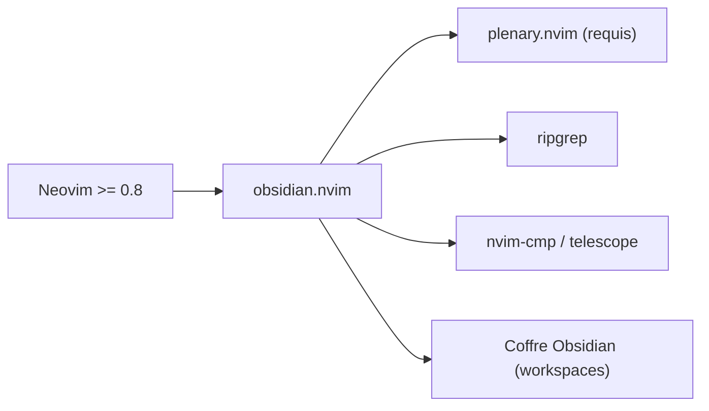

# epwalsh/obsidian.nvim

> Lua Neovim plugin for writing and navigating Obsidian vaults without leaving the editor.

## The problem
Neovim users want to work with their Obsidian notes without changing editor.

## What it actually does
Provides asynchronous completion of links and tags (nvim-cmp, ripgrep), navigation with `gf`, creation of notes and daily notes, templates, backlinks, renaming with link updates, image pasting and syntax highlighting. Possible pickers are telescope, fzf-lua and mini.pick. Workspaces can map to several vaults, including dynamic ones.

## How it is wired


## Trying it
```lua
return {
  "epwalsh/obsidian.nvim",
  version = "*",
  lazy = true,
  ft = "markdown",
  dependencies = { "nvim-lua/plenary.nvim" },
  opts = { workspaces = { { name = "personal", path = "~/vaults/personal" } } },
}
```

## Cost and gotchas
Free. `ripgrep` recommended; image pasting requires `xclip`, `wl-clipboard` or `pngpaste` depending on the OS. `:ObsidianRename` can modify many files: commit first or use `--dry-run`.

## What it is not
Not a replacement for Obsidian: no graph view and no mobile app. The README on `main` may describe unreleased features.

## Alternatives
None cited in the README.

## For you
Keep an eye on it: interesting if you keep your watch notes in an Obsidian vault and live in Neovim; otherwise of no interest.
