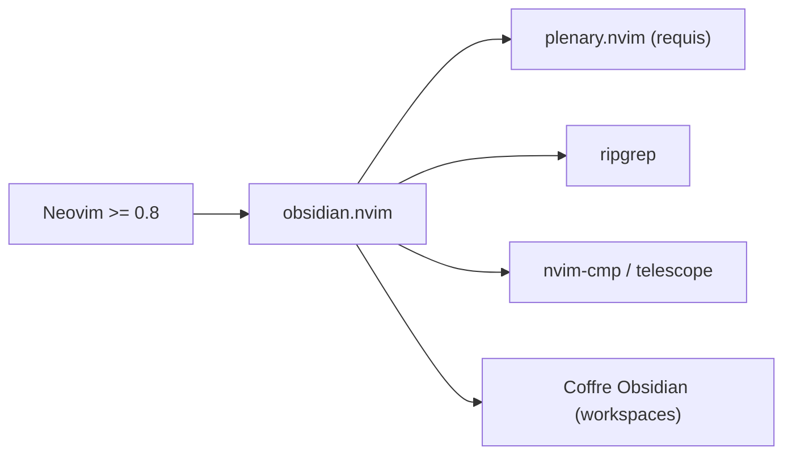

# epwalsh/obsidian.nvim

> Plugin Neovim en Lua pour écrire et naviguer dans des coffres Obsidian sans quitter l'éditeur.

## Le problème
Les utilisateurs de Neovim veulent exploiter leurs notes Obsidian sans changer d'éditeur.

## Ce que ça fait vraiment
Fournit complétion asynchrone des liens et des tags (nvim-cmp, ripgrep), navigation par `gf`, création de notes et de notes quotidiennes, modèles, rétroliens, renommage avec mise à jour des liens, collage d'images et surlignage de syntaxe. Les sélecteurs possibles sont telescope, fzf-lua et mini.pick. Les espaces de travail peuvent correspondre à plusieurs coffres, y compris dynamiques.

## Comment c'est branché


## Essayer
```lua
return {
  "epwalsh/obsidian.nvim",
  version = "*",
  lazy = true,
  ft = "markdown",
  dependencies = { "nvim-lua/plenary.nvim" },
  opts = { workspaces = { { name = "personal", path = "~/vaults/personal" } } },
}
```

## Coût et pièges
Gratuit. `ripgrep` conseillé ; collage d'images demande `xclip`, `wl-clipboard` ou `pngpaste` selon l'OS. `:ObsidianRename` peut modifier beaucoup de fichiers : committer d'abord ou utiliser `--dry-run`.

## Ce que ce n'est pas
Pas un remplaçant d'Obsidian : pas de vue graphe ni d'application mobile. Le README de `main` peut décrire des fonctions non publiées.

## Alternatives
Aucune citée dans le README.

## Pour toi
Surveiller : intéressant si tu tiens ta veille dans un coffre Obsidian et que tu vis dans Neovim ; sinon sans intérêt.

