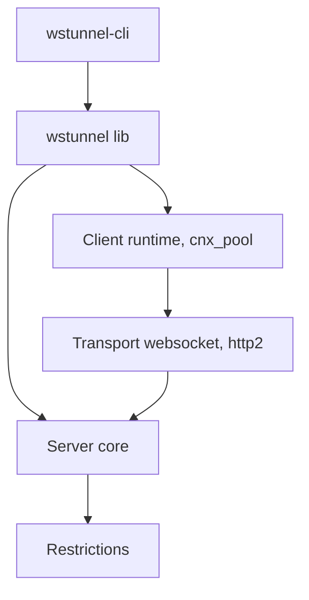

# erebe/wstunnel

> Tunnel for TCP, UDP and SOCKS5 traffic over WebSocket, HTTP/2 or WebTransport, to get through firewalls and proxies.

## The problem
Behind a corporate firewall or proxy, only HTTP and HTTPS get through, which blocks SSH or WireGuard.

## What it actually does
A wstunnel server and a client encapsulate traffic in WebSockets (or HTTP/2, WebTransport). It handles forward and reverse tunneling, a SOCKS5 or HTTP proxy, transparent proxy (Linux), stdio for SSH, mTLS, and server-side destination restrictions. Written in Rust; v7 is a rewrite not compatible with the old Haskell version.

## How it is wired
Diagram taken from the code, reduced.



## Trying it
```bash
wstunnel server wss://[::]:8080
wstunnel client -L socks5://127.0.0.1:8888 --connection-min-idle 5 wss://myRemoteHost:8080
docker pull ghcr.io/erebe/wstunnel:latest
```

## Cost and gotchas
Free; you need a reachable server. The default certificate is self-signed and TLS verification is disabled on the client by default. WebTransport requires UDP to be open. The README advises against relying on it for confidentiality.

## What it is not
Not a VPN nor an anonymity tool: it does not reliably encrypt by default. Bypassing a firewall may go against your network's policy.

## Alternatives
No alternative named in the README, apart from the unnamed inspiration project (npm, Node).

## For you
Watch: handy for reaching a GPU server or a Jupyter from a filtered network, provided you harden the TLS config.
