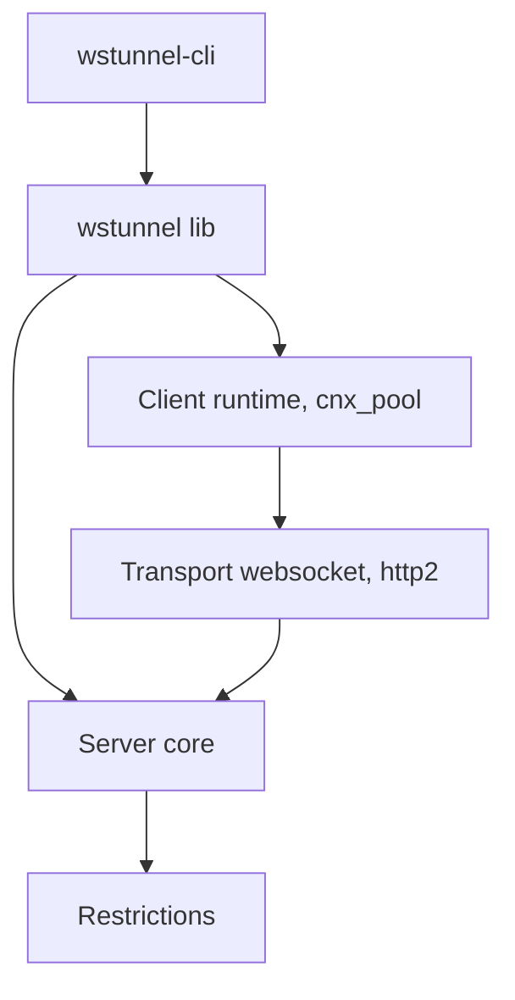

# erebe/wstunnel

> Tunnel de trafic TCP, UDP et SOCKS5 sur WebSocket, HTTP/2 ou WebTransport, pour traverser pare-feu et proxys.

## Le problème
Derrière un pare-feu ou un proxy d'entreprise, seuls HTTP et HTTPS passent, ce qui bloque SSH ou WireGuard.

## Ce que ça fait vraiment
Un serveur wstunnel et un client encapsulent le trafic dans des WebSockets (ou HTTP/2, WebTransport). Il gère le forward et le reverse tunneling, un proxy SOCKS5 ou HTTP, le proxy transparent (Linux), stdio pour SSH, mTLS, et des restrictions de destination côté serveur. Écrit en Rust ; la v7 est une réécriture non compatible avec l'ancienne version Haskell.

## Comment c'est branché
Diagramme tiré du code, réduit.



## Essayer
```bash
wstunnel server wss://[::]:8080
wstunnel client -L socks5://127.0.0.1:8888 --connection-min-idle 5 wss://myRemoteHost:8080
docker pull ghcr.io/erebe/wstunnel:latest
```

## Coût et pièges
Gratuit ; il faut un serveur accessible. Le certificat par défaut est auto-signé et la vérification TLS est désactivée côté client par défaut. WebTransport exige UDP ouvert. Le README déconseille de s'y fier pour la confidentialité.

## Ce que ce n'est pas
Pas un VPN ni un outil d'anonymat : il ne chiffre pas de façon fiable par défaut. Contourner un pare-feu peut aller contre la politique de ton réseau.

## Alternatives
Aucune alternative nommée dans le README, hors le projet d'inspiration (npm, Node) non nommé.

## Pour toi
À surveiller : pratique pour atteindre un serveur GPU ou un Jupyter depuis un réseau filtré, à condition de durcir la config TLS.

