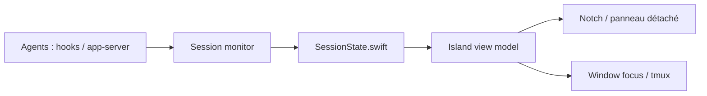

# erha19/ping-island

> macOS menu-bar app that monitors coding agent sessions and lets you reply from the notch.

## The problem
With several agents running in parallel, approval or input requests go unnoticed in terminal tabs.

## What it actually does
Receives events from the hooks of Claude Code, Codex, Gemini CLI, Qwen, Kimi, OpenCode, Cursor, Copilot and others, normalizes them, and shows a compact surface that expands when an action is needed. You can approve or deny tools, answer questions, and jump back to the right window (iTerm2, Ghostty, tmux, IDE). Supports remote SSH hosts, themes, sounds and custom mascots.

## How it is wired


## Trying it
```bash
brew install --cask ping-island
xcodebuild -project PingIsland.xcodeproj -scheme PingIsland -configuration Release build
./scripts/test.sh
```

## Cost and gotchas
Free, macOS 14+. Asks for the Accessibility and Apple Events permissions to focus windows. It installs hooks in the agents' configuration files (`~/.gemini/settings.json`, `~/.kimi/config.toml`, etc.).

## What it is not
Not an agent: it observes and relays. Positioned as a free alternative to Vibe Island; the "Telemetry" component appears in the graph but the README says nothing about it.

## Alternatives
- Vibe Island: product in the same category cited in the README.
- claude-island: project whose idea it takes over.

## For you
Watch: comfortable if you run several agents on a Mac; test it before entrusting it with tool approvals, since it can auto-approve them.
