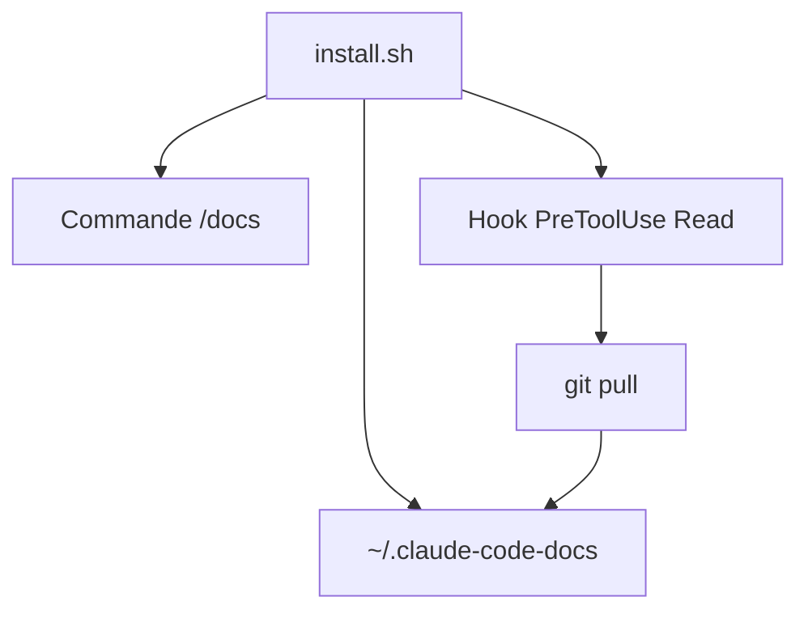

# ericbuess/claude-code-docs

> Local copy of the Claude Code documentation, accessible through a `/docs` command.

## The problem
Claude Code re-reads the documentation from the web on every question, which is slower and less convenient to explore.

## What it actually does
An install script clones the documentation into `~/.claude-code-docs`, adds the `/docs` command and a `PreToolUse` hook that runs a `git pull` when reading these files. The copy is updated every three hours. It also gives access to the changelog.

## How it is wired
Simplified diagram based on the sheet, no diagram provided.


## Trying it
```bash
curl -fsSL https://raw.githubusercontent.com/ericbuess/claude-code-docs/main/install.sh | bash
/docs hooks
/docs -t
```

## Cost and gotchas
Free, with git, jq and curl. The script modifies `~/.claude/settings.json`; Windows is not supported. Beta version.

## What it is not
It is not the official documentation: it is a third-party mirror. The license is present but unidentified.

## Alternatives
No alternative named in the README.

## For you
Keep an eye on it: handy if you use Claude Code every day, but read the script before running it, as it modifies your settings.
