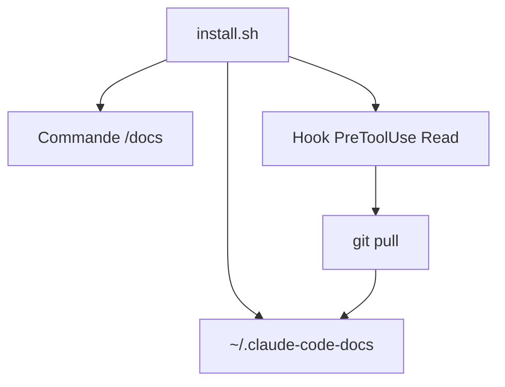

# ericbuess/claude-code-docs

> Copie locale de la documentation de Claude Code, accessible par une commande `/docs`.

## Le problème
Claude Code relit la documentation depuis le web à chaque question, ce qui est plus lent et moins pratique à explorer.

## Ce que ça fait vraiment
Un script d'installation clone la documentation dans `~/.claude-code-docs`, ajoute la commande `/docs` et un hook `PreToolUse` qui fait un `git pull` en lisant ces fichiers. La copie est mise à jour toutes les trois heures. Il donne aussi accès au journal des versions.

## Comment c'est branché
Schéma simplifié d'après la fiche, sans diagramme fourni.


## Essayer
```bash
curl -fsSL https://raw.githubusercontent.com/ericbuess/claude-code-docs/main/install.sh | bash
/docs hooks
/docs -t
```

## Coût et pièges
Gratuit, avec git, jq et curl. Le script modifie `~/.claude/settings.json` ; Windows n'est pas pris en charge. Version bêta.

## Ce que ce n'est pas
Ce n'est pas la documentation officielle : c'est un miroir d'un tiers. La licence est présente mais non identifiée.

## Alternatives
Aucune alternative nommée dans le README.

## Pour toi
À surveiller : pratique si tu utilises Claude Code chaque jour, mais lis le script avant de le lancer, car il modifie tes réglages.

