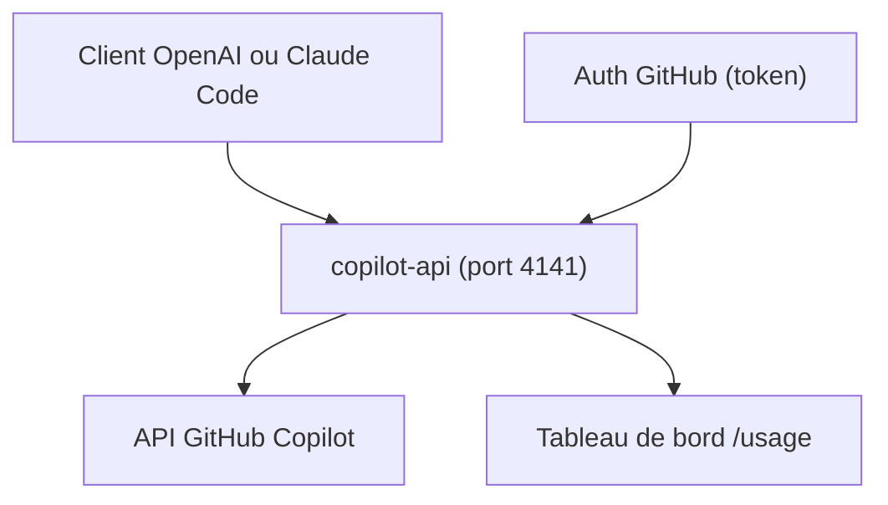

# ericc-ch/copilot-api

> Unofficial proxy that exposes GitHub Copilot as an OpenAI- and Anthropic-compatible API.

## The problem
A Copilot subscription is only usable in approved tools, not in those that expect an OpenAI or Anthropic API.

## What it actually does
A local server (port 4141) translates calls to /v1/chat/completions, /v1/embeddings and /v1/messages into the Copilot API, obtained by reverse engineering. Options: rate limiting, manual approval of each request, usage dashboard. A --claude-code flag prepares Claude Code's configuration to use Copilot as its engine.

## How it is wired
Simplified diagram based on the sheet, no diagram provided.


## Trying it
```bash
npx copilot-api@latest start
npx copilot-api@latest auth
npx copilot-api@latest check-usage
npx copilot-api@latest start --claude-code
```

## Cost and gotchas
A paid GitHub Copilot subscription is required. The README warns that excessive automated use may trigger a GitHub alert and a suspension of Copilot access.

## What it is not
It is not a product supported by GitHub: it may break without notice. It is not a way to bypass quotas. The last push dates from November 2025.

## Alternatives
opencode: supports Copilot natively, so this proxy is unnecessary there.

## For you
Watch: handy for plugging Copilot into an existing tool, but fragile and risky for your account; reserve it for limited personal use.
