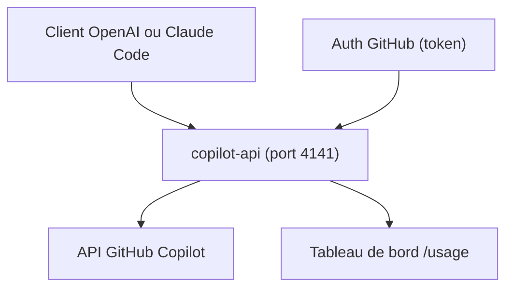

# ericc-ch/copilot-api

> Proxy non officiel qui expose GitHub Copilot comme API compatible OpenAI et Anthropic.

## Le problème
L'abonnement Copilot n'est utilisable que dans les outils agréés, pas dans ceux qui attendent une API OpenAI ou Anthropic.

## Ce que ça fait vraiment
Un serveur local (port 4141) traduit les appels /v1/chat/completions, /v1/embeddings et /v1/messages vers l'API Copilot, obtenue par rétro-ingénierie. Options : limite de débit, approbation manuelle de chaque requête, tableau de bord d'usage. Un drapeau --claude-code prépare la configuration de Claude Code pour utiliser Copilot comme moteur.

## Comment c'est branché
Schéma simplifié d'après la fiche, sans diagramme fourni.


## Essayer
```bash
npx copilot-api@latest start
npx copilot-api@latest auth
npx copilot-api@latest check-usage
npx copilot-api@latest start --claude-code
```

## Coût et pièges
Il faut un abonnement GitHub Copilot payant. Le README avertit qu'un usage automatisé excessif peut déclencher une alerte GitHub et une suspension de l'accès Copilot.

## Ce que ce n'est pas
Ce n'est pas un produit soutenu par GitHub : il peut casser sans préavis. Ce n'est pas un moyen de contourner les quotas. Le dernier push date de novembre 2025.

## Alternatives
opencode : prend en charge Copilot nativement, donc ce proxy y est inutile.

## Pour toi
Surveiller : pratique pour brancher Copilot sur un outil existant, mais fragile et risqué pour ton compte ; à réserver à un usage personnel limité.

