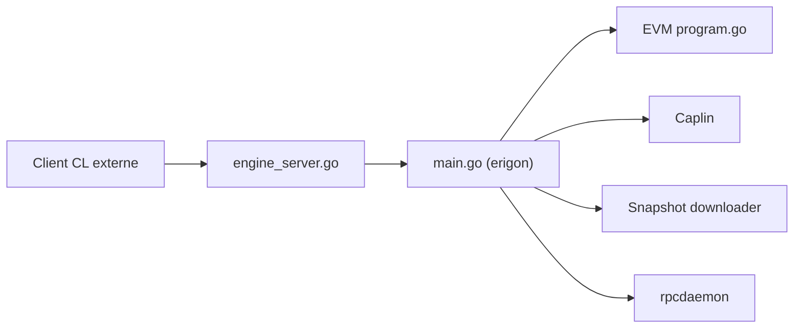

# erigontech/erigon

> Ethereum execution-layer client, optimized for efficiency, with embedded consensus (Caplin).

## The problem
Ethereum archive nodes take up enormous disk space and synchronization time.

## What it actually does
Runs the EVM, stores state and history in immutable files (snapshots), exposes JSON-RPC, GraphQL and gRPC. Caplin, the embedded consensus, is enabled by default. Pruning modes: archive, full, blocks, minimal. Components that can be launched separately: rpcdaemon, sentry, txpool, downloader.

## How it is wired


## Trying it
```sh
git clone https://github.com/erigontech/erigon.git
cd erigon
make erigon
```

## Cost and gotchas
Free. Go 1.26 and GCC 11+ or Clang 13+; x86-64-v2 processor minimum. Disk and RAM depend on the mode (see the documentation).

## What it is not
This README is aimed at contributors; running a node is covered in the external docs. LGPL-3.0.

## Alternatives
None cited in the README.

## For you
Useful for on-chain data analysis only; otherwise, ignore.
