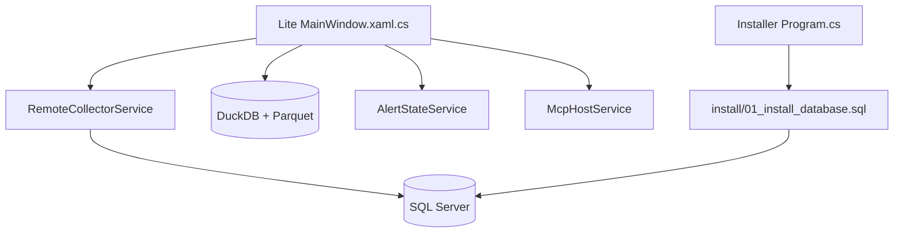

# erikdarlingdata/PerformanceMonitor

> Free SQL Server monitoring, as a desktop application or service, with an MCP server for AI agents.

## The problem
Commercial SQL Server monitoring tools are billed per server and per year. Without them, diagnosing waits, blocking and slow queries remains manual.

## What it actually does
Collects DMVs, Query Store, Extended Events and SQL Agent metadata, then displays dashboards, alerts (tray, SMTP, webhook) and analyses. The Lite edition connects remotely and stores in local DuckDB and Parquet. The Darling edition is a service that feeds a central PostgreSQL. A local MCP server exposes the data to AI clients.

## How it is wired
Diagram based on the one provided.



## Trying it
```bash
# Lite : télécharger PerformanceMonitorLite-lite-Setup.exe depuis la dernière release
# puis + Add Server, tester, enregistrer
# Darling : Install-Darling.cmd dans le dossier d'installation
# upgrade-darling.ps1 / uninstall-darling.ps1 pour la suite
```

## Cost and gotchas
Free, but a login with `VIEW SERVER STATE` is required. On versions before 3.4.0, `Setup.exe` deletes the data in the install folder. Dashboard edition deprecated.

## What it is not
It is not a SaaS: nothing is sent off your machine. Lite is mostly Windows-oriented (WPF). The agent's remediation actions are disabled until you enable them.

## Alternatives
- Redgate SQL Monitor: commercial support and established vendor.
- SolarWinds DPA: older paid suite.
- Datadog Database Monitoring: if Datadog is already in place.

## For you
Worth watching: useful only if you administer SQL Server, outside the data/AI core, but the MCP server is a good example of a tool for agents.
