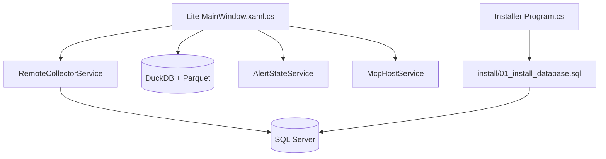

# erikdarlingdata/PerformanceMonitor

> Supervision gratuite de SQL Server, en application de bureau ou service, avec serveur MCP pour agents IA.

## Le problème
Les outils de supervision SQL Server commerciaux se facturent par serveur et par an. Sans eux, le diagnostic des attentes, blocages et requêtes lentes reste manuel.

## Ce que ça fait vraiment
Collecte DMV, Query Store, Extended Events et métadonnées SQL Agent, puis affiche tableaux de bord, alertes (tray, SMTP, webhook) et analyses. L'édition Lite se connecte à distance et stocke en DuckDB et Parquet local. L'édition Darling est un service qui alimente un PostgreSQL central. Un serveur MCP local expose les données aux clients IA.

## Comment c'est branché
Schéma d'après le diagramme fourni.



## Essayer
```bash
# Lite : télécharger PerformanceMonitorLite-lite-Setup.exe depuis la dernière release
# puis + Add Server, tester, enregistrer
# Darling : Install-Darling.cmd dans le dossier d'installation
# upgrade-darling.ps1 / uninstall-darling.ps1 pour la suite
```

## Coût et pièges
Gratuit, mais un login avec `VIEW SERVER STATE` est requis. Sur les versions antérieures à 3.4.0, `Setup.exe` supprime les données du dossier d'installation. Édition Dashboard dépréciée.

## Ce que ce n'est pas
Ce n'est pas un SaaS : rien n'est envoyé hors de ta machine. Lite est surtout orienté Windows (WPF). Les actions de remédiation de l'agent sont désactivées tant qu'on ne les active pas.

## Alternatives
- Redgate SQL Monitor : support commercial et éditeur établi.
- SolarWinds DPA : suite payante plus ancienne.
- Datadog Database Monitoring : si Datadog est déjà en place.

## Pour toi
À surveiller : utile seulement si tu administres du SQL Server, hors du cœur data/IA, mais le serveur MCP est un bon exemple d'outil pour agents.

