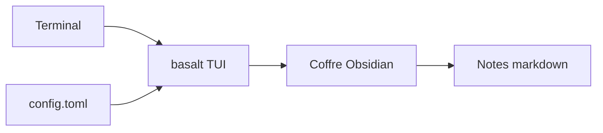

# erikjuhani/basalt

> Minimalist terminal interface to browse and edit your Obsidian vaults, for those who live in the shell.

## The problem
Opening Obsidian just to read or touch up a note breaks the terminal workflow.

## What it actually does
Basalt is a cross-platform TUI (Windows, macOS, Linux) that opens Obsidian vaults and offers a WYSIWYG rendering of notes. Configuration through an optional TOML file, with customizable shortcuts and commands. Unstable nightly builds exist.

## How it is wired
Simplified diagram based on the fiche, no diagram provided.



## Trying it
```bash
brew install erikjuhani/tap/basalt
# ou
cargo install basalt-tui
# ou
aqua g -i erikjuhani/basalt
```

## Cost and gotchas
Free, Apache-2.0 license. The config file does not exist by default; only the first one found is read, behavior that may change.

## What it is not
Not a replacement for Obsidian: a minimalist view. Known limitations exist (dedicated docs page, not detailed here).

## Alternatives
No alternative named in the README.

## For you
Worth watching: handy if your watch notes live in an Obsidian vault, but it is only editing comfort, with no impact on a data pipeline.
