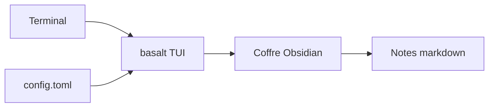

# erikjuhani/basalt

> Interface terminal minimaliste pour parcourir et éditer ses coffres Obsidian, pour qui vit dans le shell.

## Le problème
Ouvrir Obsidian juste pour lire ou retoucher une note casse le flux de travail en terminal.

## Ce que ça fait vraiment
Basalt est une TUI multiplateforme (Windows, macOS, Linux) qui ouvre des coffres Obsidian et propose un rendu WYSIWYG des notes. Configuration par fichier TOML optionnel, avec raccourcis et commandes personnalisables. Des builds nightly instables existent.

## Comment c'est branché
Schéma simplifié d'après la fiche, sans diagramme fourni.



## Essayer
```bash
brew install erikjuhani/tap/basalt
# ou
cargo install basalt-tui
# ou
aqua g -i erikjuhani/basalt
```

## Coût et pièges
Gratuit, licence Apache-2.0. Le fichier de config n'existe pas par défaut ; seul le premier trouvé est lu, comportement susceptible de changer.

## Ce que ce n'est pas
Pas un remplacement d'Obsidian : une vue minimaliste. Des limitations connues existent (page dédiée de la doc, non détaillée ici).

## Alternatives
Aucune alternative nommée dans le README.

## Pour toi
À surveiller : pratique si tes notes de veille vivent dans un coffre Obsidian, mais ce n'est qu'un confort d'édition, sans impact sur un pipeline data.

