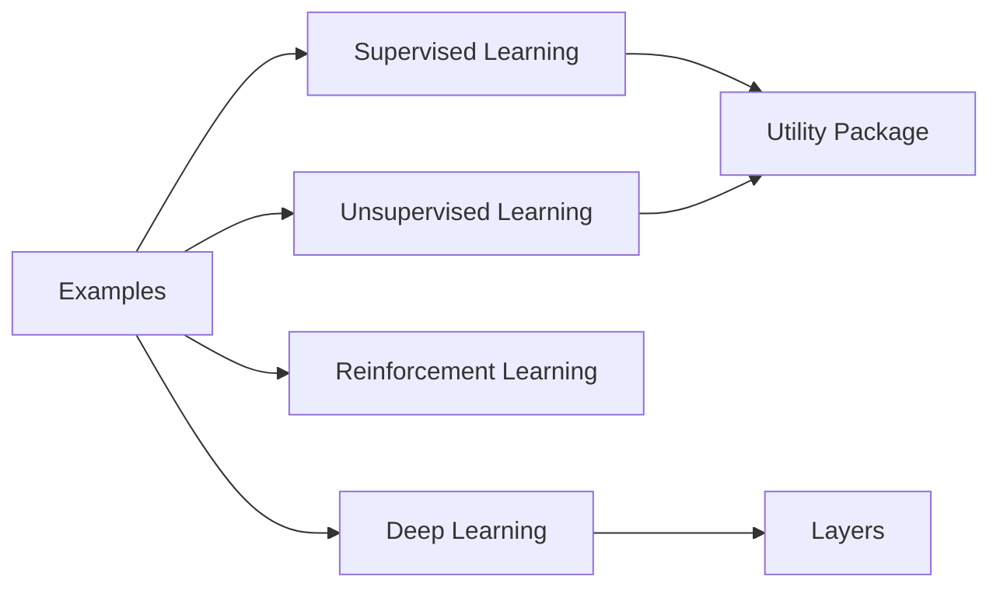

# eriklindernoren/ML-From-Scratch

> Readable NumPy implementations of classic machine learning algorithms, for learning.

## The problem
Optimized libraries hide the internal workings of the algorithms.

## What it actually does
Transparent, unoptimized Python code for ~50 algorithms: regressions, trees, boosting, XGBoost, SVM, k-means, DBSCAN, PCA, GAN, RBM, DQN, apriori.
Mini deep learning framework: layers (conv, dense, RNN, batchnorm…), activations, losses, optimizers.
Example scripts in `mlfromscratch/examples/`.

## How it is wired


## Trying it
```bash
git clone https://github.com/eriklindernoren/ML-From-Scratch
cd ML-From-Scratch
python setup.py install
python mlfromscratch/examples/polynomial_regression.py
```

## Cost and gotchas
Free, CPU. Last push in October 2023; `setup.py install` is a deprecated method.

## What it is not
Not a library to use in production: neither performance nor a stable API. No tests and no docs beyond the README.

## Alternatives
No alternative named in the README.

## For you
Excellent resource for reviewing an algorithm before an interview; nothing to deploy.
