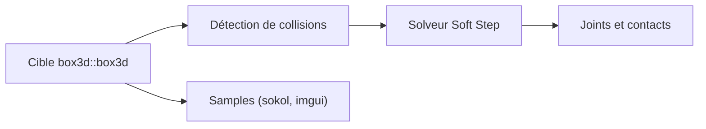

# erincatto/box3d

> A 3D physics engine for games, written in C17, for game and simulation developers.

## The problem
Simulating rigid bodies, collisions and joints in 3D requires a fast, deterministic engine.

## What it actually does
It detects continuous collisions (convex hulls, capsules, spheres, meshes, height fields), simulates rigid bodies with joints (revolute, prismatic, distance, motor, weld, wheel), island-based sleeping, multithreading and SIMD. It aims for cross-platform determinism and offers recording and replay. A samples app is provided.

## How it is wired
Simplified diagram based on the sheet, no diagram supplied.


## Trying it
```bash
cmake --preset linux-release
cmake --build --preset linux-release
./build/bin/samples
```

## Cost and gotchas
Free. A C17 compiler for the library, C++20 for the samples; CMake required. Version 0.1.0, created in May 2026. The author states they use LLMs for tests, samples and reviews.

## What it is not
Not a complete game engine: physics only. Not yet stabilized.

## Alternatives
No alternative named in the README (Box2D is cited as a migration source).

## For you
Ignore: useful for games or simulation, not for a data profile, except for a specific need in physical reinforcement learning.
