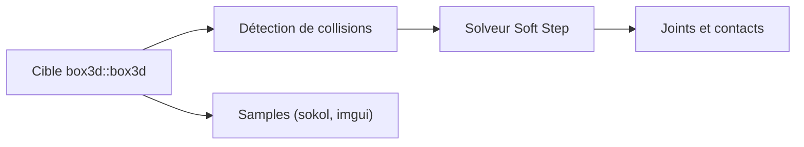

# erincatto/box3d

> Un moteur physique 3D pour jeux, écrit en C17, pour développeurs de jeux et de simulation.

## Le problème
Simuler des corps rigides, des collisions et des articulations en 3D demande un moteur rapide et déterministe.

## Ce que ça fait vraiment
Il détecte les collisions continues (enveloppes convexes, capsules, sphères, maillages, champs de hauteur), simule les corps rigides avec articulations (pivot, prismatique, distance, moteur, soudure, roue), le sommeil par îlots, le multithreading et le SIMD. Il vise le déterminisme multiplateforme et propose l'enregistrement et la relecture. Une appli d'exemples est fournie.

## Comment c'est branché
Schéma simplifié d'après la fiche, sans diagramme fourni.


## Essayer
```bash
cmake --preset linux-release
cmake --build --preset linux-release
./build/bin/samples
```

## Coût et pièges
Gratuit. Compilateur C17 pour la bibliothèque, C++20 pour les exemples ; CMake requis. Version 0.1.0, créé en mai 2026. L'auteur indique utiliser des LLM pour tests, exemples et revues.

## Ce que ce n'est pas
Pas un moteur de jeu complet : uniquement la physique. Pas encore stabilisé.

## Alternatives
Aucune alternative nommée dans le README (Box2D est cité comme source de migration).

## Pour toi
À ignorer : utile pour des jeux ou de la simulation, pas pour un profil data, sauf besoin précis en apprentissage par renforcement physique.

