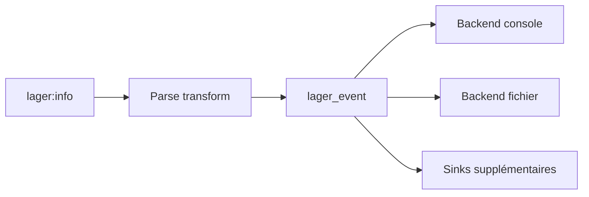

# erlang-lager/lager

> Logging framework for Erlang, compatible with logrotate and syslog, for Erlang and Elixir applications.

## The problem
Erlang's standard error logger is hard to read and integrates poorly with UNIX tools.

## What it actually does
- Eight severity levels; a parse transform captures module, function, line and pid.
- Several destinations (console, file) and several "sinks".
- Rewrites OTP error messages, overload protection (sync/async switch, sink killer).
- Internal or external rotation, filtered traces, customizable formatter.
- Syslog provided by a separate package, lager_syslog.

## How it is wired


## Trying it
```erlang
{parse_transform, lager_transform}
lager:start().
lager:error("Some message")
```

## Cost and gotchas
Free. Support policy: the last three OTP versions. The parse transform has no longer been supported by Elixir since 1.5.

## What it is not
Not a centralized observability tool. "Unsafe" mode does not protect against large messages.

## Alternatives
LagerLogger and LoggerLagerBackend (Elixir Logger side), lager_syslog for syslog.

## For you
Ignore: pure Erlang, no link with data / AI.
