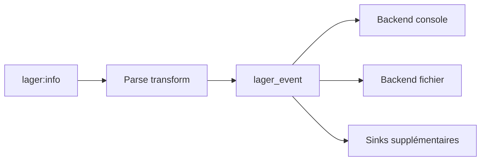

# erlang-lager/lager

> Cadre de journalisation pour Erlang, compatible avec logrotate et syslog, pour applications Erlang et Elixir.

## Le problème
Le journal d'erreurs standard d'Erlang est peu lisible et s'intègre mal aux outils UNIX.

## Ce que ça fait vraiment
- Huit niveaux de gravité ; un parse transform capture module, fonction, ligne et pid.
- Plusieurs destinations (console, fichier) et plusieurs « sinks ».
- Réécrit les messages d'erreur OTP, protection de surcharge (bascule synchrone/asynchrone, tueur de sink).
- Rotation interne ou externe, traces filtrées, formateur personnalisable.
- Syslog fourni par un paquet séparé, lager_syslog.

## Comment c'est branché


## Essayer
```erlang
{parse_transform, lager_transform}
lager:start().
lager:error("Some message")
```

## Coût et pièges
Gratuit. Politique de support : les trois dernières versions d'OTP. Le parse transform n'est plus supporté par Elixir depuis 1.5.

## Ce que ce n'est pas
Pas un outil d'observabilité centralisé. Le mode « unsafe » ne protège pas des gros messages.

## Alternatives
LagerLogger et LoggerLagerBackend (côté Elixir Logger), lager_syslog pour syslog.

## Pour toi
À ignorer : Erlang pur, aucun lien avec data / IA.

