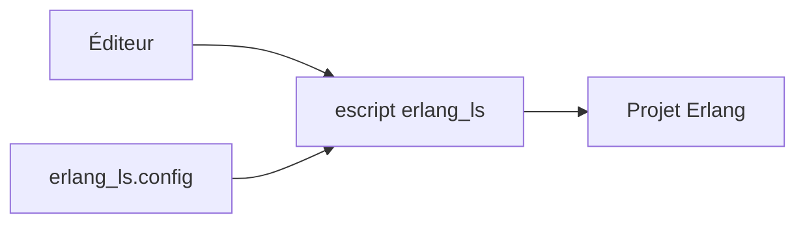

# erlang-ls/erlang_ls

> Erlang language server (LSP 3.17), now archived in favour of ELP.

## The problem
Editors need an LSP server to offer completion and navigation in Erlang.

## What it actually does
An Erlang escript implementing LSP 3.17, over tcp transport (default, port 10000) or stdio, configurable through `erlang_ls.config` or `erlang_ls.yaml`. The README states the project is unmaintained.

## How it is wired


## Trying it
```bash
make
make install
PREFIX=/path/to/directory make install
```

## Cost and gotchas
Free. Prerequisites: Erlang OTP 24+ and rebar3 3.9.1+. Repository archived, last push August 2025.

## What it is not
It is no longer maintained; do not pick it for a new setup.

## Alternatives
Erlang Language Platform (ELP): recommended by the README, actively maintained.

## For you
Ignore: archived and unrelated to data/AI; go straight to ELP if you write Erlang.
