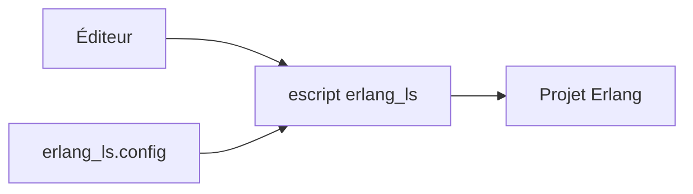

# erlang-ls/erlang_ls

> Serveur de langage Erlang (LSP 3.17), aujourd'hui archivé au profit d'ELP.

## Le problème
Les éditeurs ont besoin d'un serveur LSP pour offrir complétion et navigation en Erlang.

## Ce que ça fait vraiment
Un escript Erlang qui implémente LSP 3.17, en transport tcp (défaut, port 10000) ou stdio, configurable par `erlang_ls.config` ou `erlang_ls.yaml`. Le README annonce le projet non maintenu.

## Comment c'est branché


## Essayer
```bash
make
make install
PREFIX=/path/to/directory make install
```

## Coût et pièges
Gratuit. Prérequis : Erlang OTP 24+ et rebar3 3.9.1+. Dépôt archivé, dernier push août 2025.

## Ce que ce n'est pas
Ce n'est plus maintenu ; ne pas le choisir pour un nouveau poste.

## Alternatives
Erlang Language Platform (ELP) : recommandé par le README, activement maintenu.

## Pour toi
À ignorer : archivé et sans lien avec data/IA ; passe directement à ELP si tu écris de l'Erlang.

