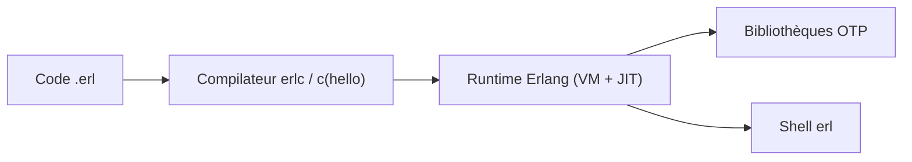

# erlang/otp

> The Erlang language and OTP libraries for concurrent, fault-tolerant, soft real-time systems.

## The problem
Building massively concurrent, highly available services without reinventing supervisors and messaging.

## What it actually does
Provides the Erlang runtime (virtual machine, JIT), ready-to-use components written mostly in Erlang, and design principles for programs. The repository contains the sources; you install it through a system package or by building (`configure`, `make`). The README gives a minimal `hello:world()` example in the shell.

## How it is wired


## Trying it
```bash
apt-get install erlang
git clone https://github.com/erlang/otp.git && cd otp
git checkout maint-27
./configure && make && make install
```

## Cost and gotchas
Free. Building from source requires a toolchain (see the repository's full instructions). More than 600 open issues.

## What it is not
Not a data science or numerical computing tool. A language to learn, not a Python library.

## Alternatives
None cited in the README, apart from the awesome-erlang list.

## For you
Keep an eye on it: a reference for fault tolerance, but only worth learning if you build a real-time service; not useful for an ordinary data/AI pipeline.
