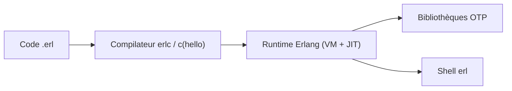

# erlang/otp

> Langage Erlang et bibliothèques OTP pour systèmes concurrents, tolérants aux pannes, de type temps réel souple.

## Le problème
Construire des services massivement concurrents et très disponibles sans réinventer superviseurs et messagerie.

## Ce que ça fait vraiment
Fournit le runtime Erlang (machine virtuelle, JIT), des composants prêts à l'emploi écrits surtout en Erlang et des principes de conception pour les programmes. Le dépôt contient les sources ; on l'installe par paquet système ou par compilation (`configure`, `make`). Le README donne un exemple minimal `hello:world()` dans le shell.

## Comment c'est branché


## Essayer
```bash
apt-get install erlang
git clone https://github.com/erlang/otp.git && cd otp
git checkout maint-27
./configure && make && make install
```

## Coût et pièges
Gratuit. La compilation depuis les sources demande une chaîne d'outils (voir les instructions complètes du dépôt). Plus de 600 issues ouvertes.

## Ce que ce n'est pas
Pas un outil de data science ni de calcul numérique. Un langage à apprendre, pas une bibliothèque Python.

## Alternatives
Aucune citée dans le README, hors liste awesome-erlang.

## Pour toi
Surveiller : référence pour la tolérance aux pannes, mais à n'apprendre que si tu construis un service temps réel ; pas utile pour un pipeline data/IA ordinaire.

