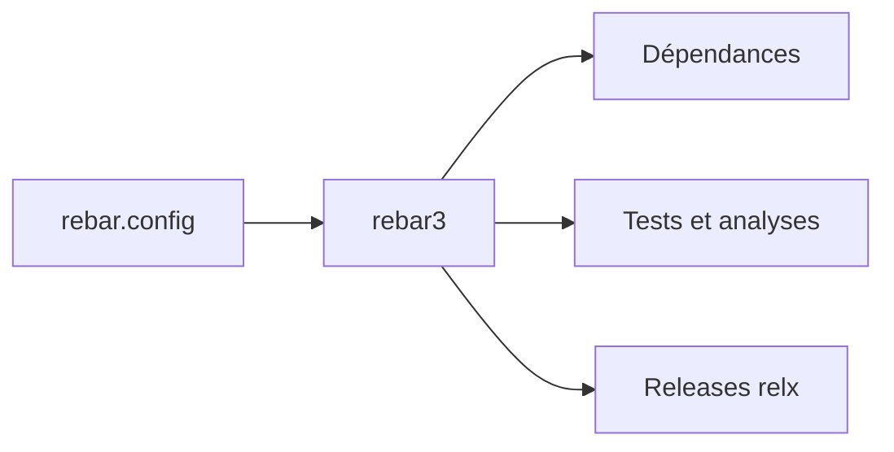

# erlang/rebar3

> Build and dependency management tool for Erlang, for teams that ship Erlang applications.

## The problem
Compiling, testing and shipping Erlang projects reproducibly, with a standard structure.

## What it actually does
- Handles compilation, locked dependencies, profiles (`test`, `prod`) and plugins.
- Runs Eunit, Common Test, Dialyzer, Xref, code coverage, release generation (relx) and tarballs.
- Project templates via `rebar3 new`.
- A table gives the Rebar3 versions compatible with Erlang/OTP; it flags CVEs fixed since 3.27.x.

## How it is wired


## Trying it
```bash
wget https://s3.amazonaws.com/rebar3/rebar3 && chmod +x rebar3
./rebar3 local install
```

## Cost and gotchas
Free. A full Erlang/OTP is required to compile from source. Some versions are to be avoided (3.13.1 to 3.13.2, 3.15.0 to 3.15.1, 3.16.0).

## What it is not
Not a tool for Python or Java. Does not replace a pipeline orchestrator.

## Alternatives
Rebar 2.x (predecessor, abandoned by its authors in favor of Rebar3).

## For you
Ignore unless you maintain Erlang code: nothing to do with data / AI tools.
