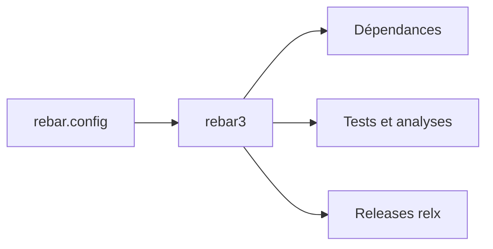

# erlang/rebar3

> Outil de build et de gestion de dépendances pour Erlang, pour les équipes qui livrent des applications Erlang.

## Le problème
Compiler, tester et livrer des projets Erlang de façon reproductible, avec une structure standard.

## Ce que ça fait vraiment
- Gère compilation, dépendances verrouillées, profils (`test`, `prod`) et plugins.
- Lance Eunit, Common Test, Dialyzer, Xref, couverture de code, génération de releases (relx) et tarballs.
- Modèles de projets via `rebar3 new`.
- Un tableau donne les versions de Rebar3 compatibles avec Erlang/OTP ; il signale des CVE corrigées depuis la 3.27.x.

## Comment c'est branché


## Essayer
```bash
wget https://s3.amazonaws.com/rebar3/rebar3 && chmod +x rebar3
./rebar3 local install
```

## Coût et pièges
Gratuit. Un Erlang/OTP complet est nécessaire pour compiler depuis les sources. Certaines versions sont à éviter (3.13.1 à 3.13.2, 3.15.0 à 3.15.1, 3.16.0).

## Ce que ce n'est pas
Pas un outil pour Python ou Java. Ne remplace pas un orchestrateur de pipelines.

## Alternatives
Rebar 2.x (ancêtre, abandonné par ses auteurs au profit de Rebar3).

## Pour toi
À ignorer sauf si tu maintiens du code Erlang : rien à voir avec les outils data / IA.

