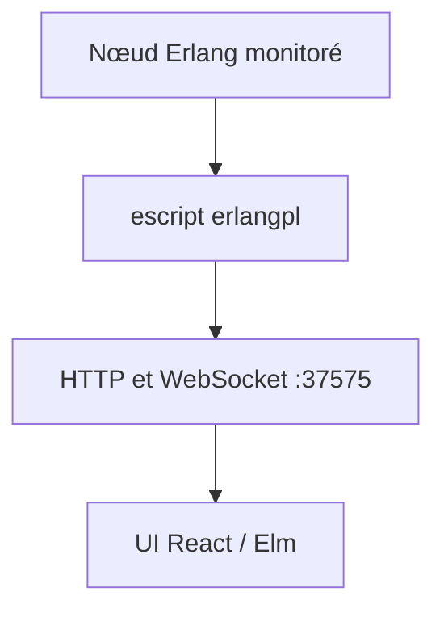

# erlanglab/erlangpl

> Performance analysis tool for systems running on the Erlang virtual machine (BEAM).

## The problem
Observing the processes, messages and nodes of a running Erlang or Elixir system is hard without a dedicated interface.

## What it actually does
An Erlang escript connects to a distributed node (name and cookie), then serves a web interface on port 37575. The README mentions examples with an Elixir `iex` session and a Mnesia cluster. The interface is in React with optional Elm components.

## How it is wired
Simplified diagram based on the sheet, no diagram provided.



## Trying it
```bash
wget https://github.com/erlanglab/erlangpl/releases/download/0.9.0/erlangpl.tar.gz
tar -zxvf erlangpl.tar.gz
./erlangpl -n NODE_NAME -c COOKIE
```

## Cost and gotchas
Free. Requires Erlang/OTP 19.3 or later, a node in distributed mode and an identical cookie. Building the UI requires node, yarn and elm. Archived repository, last push in 2021.

## What it is not
Not a maintained tool: version 0.9.0, archived. Not generic monitoring: it targets only the BEAM.

## Alternatives
No alternative named in the README.

## For you
Ignore: archived since 2021 and limited to the Erlang ecosystem, unrelated to a data/AI/MLOps profile.
