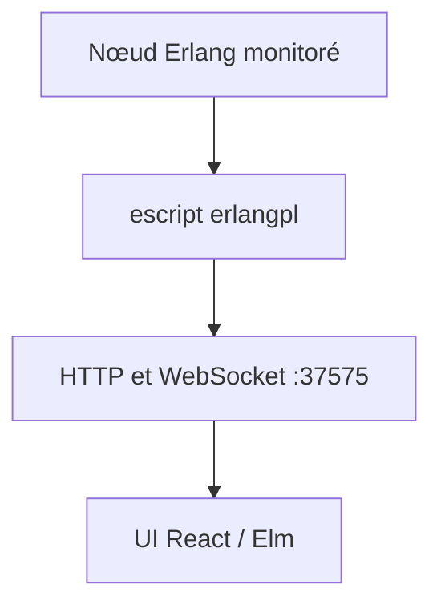

# erlanglab/erlangpl

> Outil d'analyse de performance pour systèmes tournant sur la machine virtuelle Erlang (BEAM).

## Le problème
Observer les processus, messages et nœuds d'un système Erlang ou Elixir en cours d'exécution est difficile sans interface dédiée.

## Ce que ça fait vraiment
Un escript Erlang se connecte à un nœud distribué (nom et cookie), puis sert une interface web sur le port 37575. Le README mentionne des exemples avec une session Elixir `iex` et un cluster Mnesia. L'interface est en React avec des composants Elm optionnels.

## Comment c'est branché
Schéma simplifié d'après la fiche, sans diagramme fourni.



## Essayer
```bash
wget https://github.com/erlanglab/erlangpl/releases/download/0.9.0/erlangpl.tar.gz
tar -zxvf erlangpl.tar.gz
./erlangpl -n NODE_NAME -c COOKIE
```

## Coût et pièges
Gratuit. Il faut Erlang/OTP 19.3 ou plus, un nœud en mode distribué et un cookie identique. La compilation de l'UI demande node, yarn et elm. Dépôt archivé, dernier push en 2021.

## Ce que ce n'est pas
Pas un outil maintenu : version 0.9.0, archivé. Pas un monitoring générique : il ne vise que la BEAM.

## Alternatives
Aucune alternative nommée dans le README.

## Pour toi
À ignorer : archivé depuis 2021 et limité à l'écosystème Erlang, sans rapport avec un profil data/IA/MLOps.

