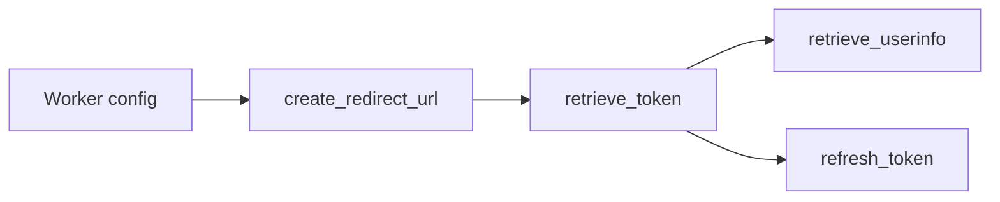

# erlef/oidcc

> OpenID Connect client library for Erlang and Elixir, certified by the OpenID Foundation.

## The problem
Plugging OIDC authentication into an Erlang/Elixir application requires a compliant client.

## What it actually does
A worker caches the provider configuration; the API creates the redirect URL, exchanges the code, loads userinfo, introspects and refreshes tokens. Integrations `oidcc_plug`, `ueberauth_oidcc`; `oidcc_cowboy` is deprecated. OTP27 minimum. SAFE-Erlang-Elixir security audit.

## How it is wired


## Trying it
```bash
mix oidcc.gen.provider_configuration_worker --name MyApp.OidccConfigProvider --issuer https://accounts.google.com
```

## Cost and gotchas
Free. You need an OIDC identity provider and a registered client.

## What it is not
Not an identity server: client side only.

## Alternatives
No alternative named in the README.

## For you
Ignore: solid but confined to the BEAM ecosystem, outside data/AI.
