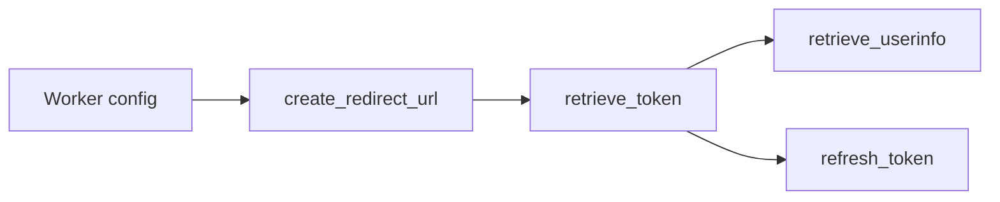

# erlef/oidcc

> Bibliothèque cliente OpenID Connect pour Erlang et Elixir, certifiée par l'OpenID Foundation.

## Le problème
Brancher une authentification OIDC sur une appli Erlang/Elixir demande un client conforme.

## Ce que ça fait vraiment
Un worker met en cache la configuration du fournisseur ; l'API crée l'URL de redirection, échange le code, charge userinfo, introspecte et rafraîchit les jetons. Intégrations `oidcc_plug`, `ueberauth_oidcc` ; `oidcc_cowboy` est déprécié. OTP27 minimum. Audit de sécurité SAFE-Erlang-Elixir.

## Comment c'est branché


## Essayer
```bash
mix oidcc.gen.provider_configuration_worker --name MyApp.OidccConfigProvider --issuer https://accounts.google.com
```

## Coût et pièges
Gratuit. Il faut un fournisseur d'identité OIDC et un client enregistré.

## Ce que ce n'est pas
Pas un serveur d'identité : seulement le côté client.

## Alternatives
Aucune alternative nommée dans le README.

## Pour toi
À ignorer : solide mais cantonné à l'écosystème BEAM, hors data/IA.

