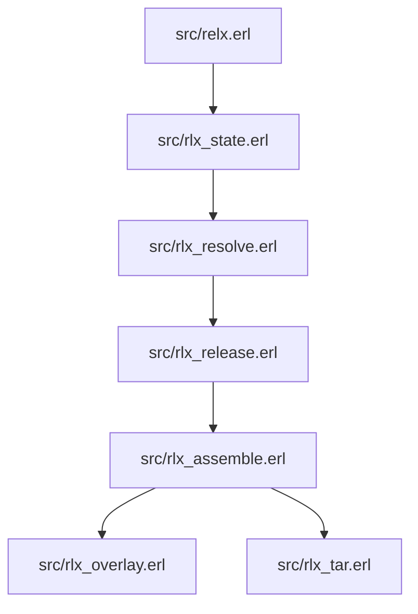

# erlware/relx

> Library that assembles Erlang/OTP releases, used mostly via rebar3.

## The problem
Shipping an Erlang/OTP application requires gathering applications, startup scripts and configuration.

## What it actually does
From a release specification and OTP application directories, generates the release: application resolution, copying, overlays, startup scripts from `priv/templates` and an optional archive (`rlx_tar`). No command-line interface of its own: rebar3 serves as the front end.

## How it is wired


## Trying it
```bash
rebar3 compile
rebar3 ct
shelltests/run_tests.sh
```

## Cost and gotchas
Free. Consumed via rebar3; usage documentation is on rebar3.org, not in this repository.

## What it is not
Not a standalone tool: it is a library, the README points to rebar3.

## Alternatives
No alternative named in the README.

## For you
Concerns the Erlang ecosystem only: ignore.
