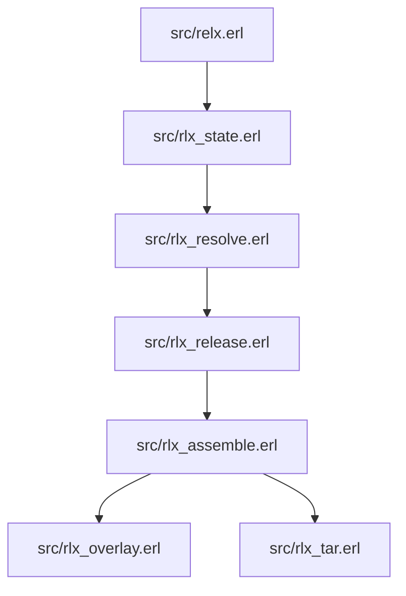

# erlware/relx

> Bibliothèque qui assemble des releases Erlang/OTP, utilisée surtout via rebar3.

## Le problème
Livrer une application Erlang/OTP exige de rassembler applications, scripts de démarrage et configuration.

## Ce que ça fait vraiment
À partir d'une spécification de release et de répertoires d'applications OTP, génère la release : résolution des applications, copie, overlays, scripts de démarrage depuis `priv/templates` et archive optionnelle (`rlx_tar`). Pas d'interface en ligne de commande propre : rebar3 sert de façade.

## Comment c'est branché


## Essayer
```bash
rebar3 compile
rebar3 ct
shelltests/run_tests.sh
```

## Coût et pièges
Gratuit. Se consomme via rebar3 ; la documentation d'usage est sur rebar3.org, pas dans ce dépôt.

## Ce que ce n'est pas
Pas un outil autonome : c'est une bibliothèque, le README renvoie à rebar3.

## Alternatives
Aucune alternative nommée dans le README.

## Pour toi
Concerne l'écosystème Erlang seulement : à ignorer.

