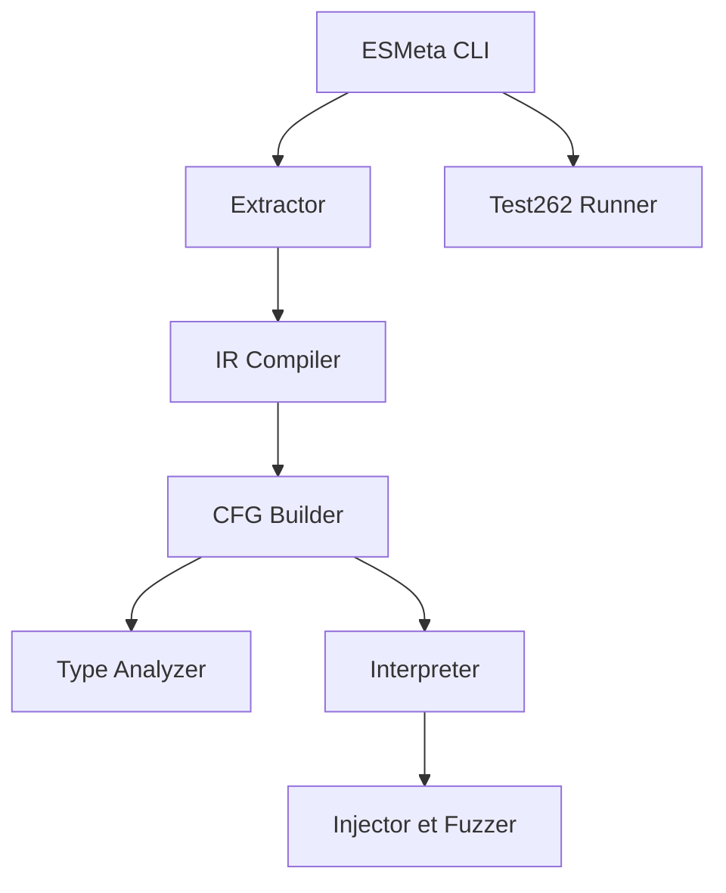

# es-meta/esmeta

> Tools generated from the ECMAScript specification: interpreter, debugger, test synthesis, for programming-language researchers.

## The problem
The ECMA-262 specification is written in prose: hard to execute, to type, or to check against the Test262 tests.

## What it actually does
ESMeta extracts a model from the specification, compiles it into an intermediate representation and then into a control-flow graph, which serves as a JavaScript interpreter. On top of it: a double debugger, type analysis, Test262 tests, program synthesis through fuzzing, and assertion injection.

## How it is wired


## Trying it
```bash
git clone https://github.com/es-meta/esmeta.git
cd esmeta && git submodule update --init && sbt assembly && source .completion
esmeta parse example.js
esmeta eval example.js
esmeta tycheck
```

## Cost and gotchas
Free. Requires JDK 17 or later, sbt, Scala, and the ESMETA_HOME variable. The meta-level static analyzer is temporarily removed.

## What it is not
Not a JavaScript engine usable in production: it is a research tool on the specification.

## Alternatives
No alternative named in the README.

## For you
Ignore: language research, with no direct application in data, AI or MLOps.
