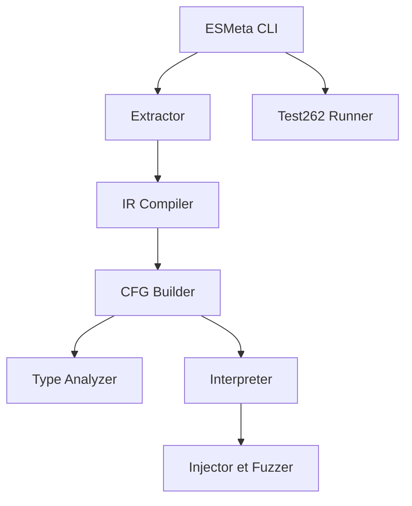

# es-meta/esmeta

> Outils générés depuis la spécification ECMAScript : interpréteur, débogueur, synthèse de tests, pour chercheurs en langages.

## Le problème
La spécification ECMA-262 est écrite en prose : difficile de l'exécuter, de la typer ou de la confronter aux tests Test262.

## Ce que ça fait vraiment
ESMeta extrait un modèle de la spécification, le compile en représentation intermédiaire puis en graphe de flot de contrôle, qui sert d'interpréteur JavaScript. Dessus : double débogueur, analyse de types, tests Test262, synthèse de programmes par fuzzing et injection d'assertions.

## Comment c'est branché


## Essayer
```bash
git clone https://github.com/es-meta/esmeta.git
cd esmeta && git submodule update --init && sbt assembly && source .completion
esmeta parse example.js
esmeta eval example.js
esmeta tycheck
```

## Coût et pièges
Gratuit. Il faut JDK 17 ou plus, sbt, Scala, et la variable ESMETA_HOME. L'analyseur statique meta-niveau est temporairement retiré.

## Ce que ce n'est pas
Pas un moteur JavaScript utilisable en production : c'est un outil de recherche sur la spécification.

## Alternatives
Aucune alternative nommée dans le README.

## Pour toi
À ignorer : de la recherche sur les langages, sans application directe en data, IA ou MLOps.

