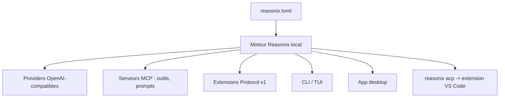

# esengine/DeepSeek-Reasonix

> Single-binary coding agent, driven by configuration, with a CLI, a desktop app and a VS Code extension.

## The problem
Coding agents come tied to a model and an editor, and you have to install a whole stack to try them.
Changing provider means changing tools, not changing a line of configuration.

## What it actually does
Everything is declared in `reasonix.toml`: providers, agent, enabled tools, plugins. No hard-coded model.
DeepSeek is a preset, but any OpenAI-compatible endpoint is a configuration entry; two models can run together (executor + planner) in separate sessions with a stable cache.
MCP servers bring tools, prompts and resources; "Extension Protocol v1" sidecars intercept runtime events and provide Providers and structured UI.
Context maintenance: a stable environment summary injected at startup, and stale tool outputs pruned before compaction.

## How it is wired


## Trying it
```sh
npm i -g reasonix
reasonix setup
reasonix run "implement the TODOs in main.go"
```

## Cost and gotchas
MIT license, static binary `CGO_ENABLED=0`: nothing to install on the target machine. Model calls remain at your expense.
Building from source: Go 1.26+ for the CLI, plus Node 24+ and pnpm 10 for the desktop app.

## What it is not
It is not tied to DeepSeek despite the repository name: DeepSeek is only one preset among others.
The VS Code extension does not bundle the CLI: you have to install the binary first.
Community project with many contributors but young; the announced donations "buy neither priority nor triage".

## Alternatives
No competing agent is named in the README.

## For you
Worth watching if you want a local coding agent whose model provider is a line of config.
