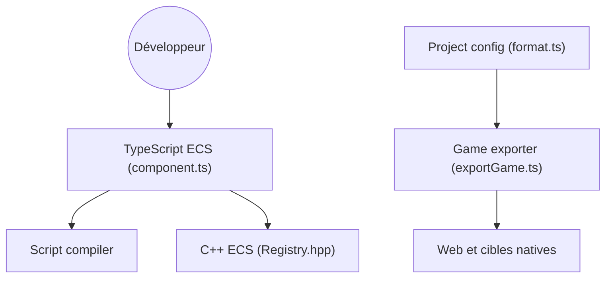

# esengine/estella

> 2D and 3D game engine whose editor is an MCP server, driven by AI agents.

## The problem
AI agents code around game editors without access to the same actions as the interface.

## What it actually does
The editor exposes 181 MCP tools (scene, game, screenshots, assets, scripts, export) going through the same pipelines as its interface, each undoable via Undo, read-only until you authorize the agent. C++ engine with a TypeScript SDK, web export, Chinese mini-games, playable ads, native desktop and mobile. Tools are loaded in groups to save tokens. The repository does not contain the editor's code.

## How it is wired


## Trying it
```bash
# Pas de commande dans le README : télécharger l'éditeur sur estellaengine.com,
# puis Window > Connect AI Tools pour configurer un client MCP.
```

## Cost and gotchas
Free editor, Apache-2.0 runtime. 3D model generation through Tripo AI with your own key and credits. The repository does not accept pull requests.

## What it is not
Not an open-source editor (only the runtime, SDK, pipeline and CLI are). The demos and claims come from the author.

## Alternatives
Unity and Unreal, cited as editors that also have MCP.

## For you
Keep an eye on it: a concrete example of an MCP-driven editor, useful for inspiration, but outside your core field.
