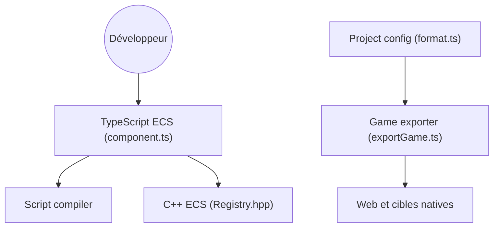

# esengine/estella

> Moteur de jeu 2D et 3D dont l'éditeur est un serveur MCP, piloté par des agents IA.

## Le problème
Les agents IA codent autour des éditeurs de jeu sans accès aux mêmes actions que l'interface.

## Ce que ça fait vraiment
L'éditeur expose 181 outils MCP (scène, jeu, captures, assets, scripts, export) passant par les mêmes pipelines que son interface, chacun annulable par Undo, en lecture seule tant que tu n'autorises pas l'agent. Moteur C++ avec SDK TypeScript, export web, mini-jeux chinois, publicités jouables, bureau et mobile natifs. Les outils sont chargés par groupes pour économiser des jetons. Le dépôt ne contient pas le code de l'éditeur.

## Comment c'est branché


## Essayer
```bash
# Pas de commande dans le README : télécharger l'éditeur sur estellaengine.com,
# puis Window > Connect AI Tools pour configurer un client MCP.
```

## Coût et pièges
Éditeur gratuit, runtime Apache-2.0. Génération de modèles 3D via Tripo AI avec ta propre clé et tes crédits. Le dépôt n'accepte pas les pull requests.

## Ce que ce n'est pas
Pas un éditeur open source (seuls runtime, SDK, pipeline et CLI le sont). Les démos et revendications viennent de l'auteur.

## Alternatives
Unity et Unreal, cités comme éditeurs qui ont aussi du MCP.

## Pour toi
À surveiller : exemple concret d'éditeur piloté par MCP, utile pour s'inspirer, mais hors cœur de métier.

