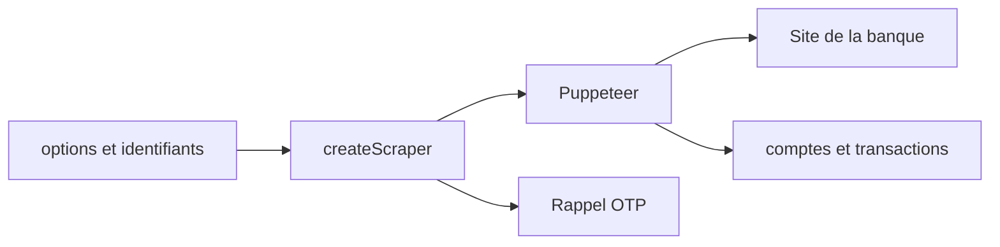

# eshaham/israeli-bank-scrapers

> Node library that retrieves transactions from Israeli banks and credit cards.

## The problem
Israeli banks offer no open API to retrieve your own transactions.

## What it actually does
One scraper per institution (Hapoalim, Leumi, Discount, Visa Cal, Max, Isracard, Amex, OneZero, etc.), driven by Puppeteer. `createScraper` returns accounts, balances and transactions (date, amount, currency, status, installments). It handles two-factor authentication through an OTP code callback or a long-term token. A `-core` variant uses `puppeteer-core` for Electron.

## How it is wired
Simplified diagram based on the fiche, no diagram provided.


## Trying it
```sh
npm install israeli-bank-scrapers --save
```
```node
import { CompanyTypes, createScraper } from 'israeli-bank-scrapers';
```

## Cost and gotchas
Node.js 22.22.2 or later. You supply your real bank credentials and a Chromium is downloaded (several hundred MB). The timezone is forced to Asia/Jerusalem. Scrapers break when a bank site changes (not documented).

## What it is not
Not an official API: it is site scraping. It covers only Israeli banks. Some scrapers are experimental, such as OneZero.

## Alternatives
No alternative named in the README (it lists projects that use it, such as Moneyman and Firefly iii Importer).

## For you
Ignore: limited to Israeli accounts, unrelated to your work, and it handles bank credentials.
