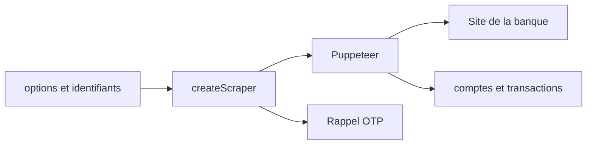

# eshaham/israeli-bank-scrapers

> Bibliothèque Node qui récupère les transactions des banques et cartes de crédit israéliennes.

## Le problème
Les banques israéliennes n'offrent pas d'API ouverte pour récupérer ses propres transactions.

## Ce que ça fait vraiment
Un scraper par établissement (Hapoalim, Leumi, Discount, Visa Cal, Max, Isracard, Amex, OneZero, etc.), piloté par Puppeteer. `createScraper` renvoie comptes, soldes et transactions (date, montant, devise, statut, échéances). Elle gère la double authentification par rappel de code OTP ou jeton long terme. Une variante `-core` utilise `puppeteer-core` pour Electron.

## Comment c'est branché
Schéma simplifié d'après la fiche, sans diagramme fourni.


## Essayer
```sh
npm install israeli-bank-scrapers --save
```
```node
import { CompanyTypes, createScraper } from 'israeli-bank-scrapers';
```

## Coût et pièges
Node.js 22.22.2 ou plus. Tu fournis tes vrais identifiants bancaires et un Chromium est téléchargé (plusieurs centaines de Mo). Le fuseau est forcé sur Asia/Jerusalem. Les scrapers cassent quand un site de banque change (non documenté).

## Ce que ce n'est pas
Ce n'est pas une API officielle : c'est du scraping de sites. Il ne couvre que des banques israéliennes. Certains scrapers sont expérimentaux, comme OneZero.

## Alternatives
Aucune alternative nommée dans le README (il liste des projets qui l'utilisent, comme Moneyman et Firefly iii Importer).

## Pour toi
À ignorer : réservé aux comptes israéliens, sans lien avec ton métier, et il manipule des identifiants bancaires.

