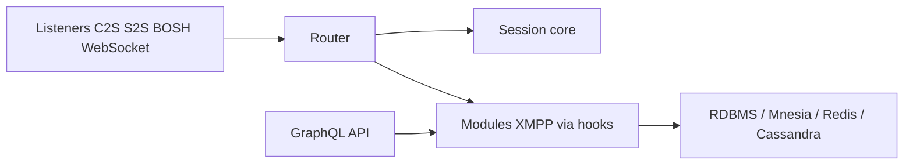

# esl/MongooseIM

> Scalable, clusterable XMPP messaging server written in Erlang, for large instant-messaging deployments.

## The problem
Running a fault-tolerant XMPP chat server that scales by adding machines.

## What it actually does
XMPP server on the BEAM accepting XMPP, REST, SSE, WebSocket and BOSH. Features are hook-based modules (MAM, MUC, pubsub, inbox…) on interchangeable backends (RDBMS, Mnesia/CETS, Cassandra, Redis, Elasticsearch). Exposes an admin and user GraphQL API, metrics and clustering. Shipped as a Docker image, Helm chart and packages.

## How it is wired


## Trying it
```bash
# Aucune commande dans le README : télécharger l'image Docker, le chart Helm ou les paquets.
```

## Cost and gotchas
Free; choosing and operating the storage backends is the real work. Published by Erlang Solutions.

## What it is not
Not a turnkey chat: it is an infrastructure server. A license is present but not identified by GitHub.

## Alternatives
No alternative named in the README.

## For you
Ignore: an XMPP messaging server is outside your data/AI/MLOps scope, unless you have a specific need for self-hosted chat.
