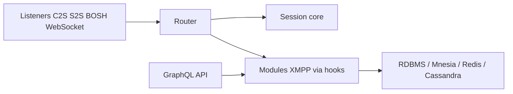

# esl/MongooseIM

> Serveur de messagerie XMPP en Erlang, scalable et clusterisable, pour grandes installations de messagerie instantanée.

## Le problème
Opérer un serveur de chat XMPP tolérant aux pannes qui monte en charge en ajoutant des machines.

## Ce que ça fait vraiment
Serveur XMPP sur BEAM acceptant XMPP, REST, SSE, WebSocket et BOSH. Les fonctionnalités sont des modules à hooks (MAM, MUC, pubsub, inbox…) sur des backends interchangeables (RDBMS, Mnesia/CETS, Cassandra, Redis, Elasticsearch). Expose une API GraphQL admin et utilisateur, des métriques et du clustering. Fourni en image Docker, chart Helm et paquets.

## Comment c'est branché


## Essayer
```bash
# Aucune commande dans le README : télécharger l'image Docker, le chart Helm ou les paquets.
```

## Coût et pièges
Gratuit ; choisir et opérer les backends de stockage est le vrai travail. Édité par Erlang Solutions.

## Ce que ce n'est pas
Pas un chat clé en main : c'est un serveur d'infrastructure. Licence présente mais non identifiée par GitHub.

## Alternatives
Aucune alternative nommée dans le README.

## Pour toi
À ignorer : serveur de messagerie XMPP hors de ton périmètre data/IA/MLOps, sauf besoin précis de chat auto-hébergé.

