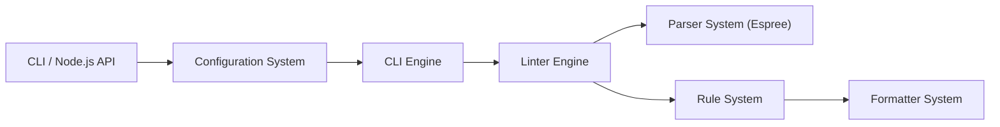

# eslint/eslint

> Pluggable JavaScript linter that spots problematic patterns in code via its syntax tree.

## The problem
Style and logic errors in JavaScript slip past code review; an automatic, configurable check is needed.

## What it actually does
Parses code with the Espree parser, evaluates rules on the AST (each rule is a plugin) and reports or auto-fixes. Configuration in `eslint.config.js` with off, warn, error levels. Plugins and parsers (Babel, TypeScript) extend coverage. Semver versions with a stated policy: a minor update may surface new errors.

## How it is wired


## Trying it
```bash
npm init @eslint/config@latest
npx eslint yourfile.js
```

## Cost and gotchas
Free. Node ^20.19.0, ^22.13.0 or >=24 required. The README recommends a `~` in `package.json` to pin lint results. With pnpm, `.npmrc` settings are advised.

## What it is not
It is not a formatter: the README states that Prettier has a different role and that both are often used together. It officially supports only the latest ECMAScript standard.

## Alternatives
- JSLint and JSHint: cited as similar tools; ESLint is more pluggable.
- Prettier: to pair with, not to oppose.

## For you
Watch: essential if you write front-end or Node tooling, of no direct interest for Python-centered work.
