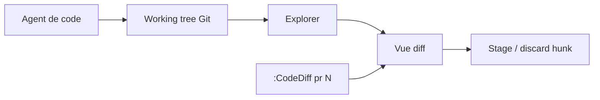

# esmuellert/codediff.nvim

> Neovim plugin for VSCode-style diff review, to read live what a coding agent produces.

## The problem
An agent modifies the repository in the background; reviewing its changes in Neovim with the native diff tools is painful.

## What it actually does
`:CodeDiff` opens an explorer of modified files with side-by-side or inline diffs, at line and character level, refreshed as changes happen. You can stage or discard files and hunks, review pull requests (GitHub, GitLab, Azure DevOps) without checkout, browse history, compare files and folders, and resolve merge conflicts. A native library is downloaded on first use.

## How it is wired


## Trying it
```bash
:CodeDiff
:CodeDiff main...
:CodeDiff pr 512
:CodeDiff history
git difftool main feature-branch
```
Installation: `{ "esmuellert/codediff.nvim", cmd = "CodeDiff" }` in lazy.nvim.

## Cost and gotchas
Neovim 0.7 minimum (0.10 recommended), Git, `curl` or `wget` for the precompiled binary. If the download is not possible, manual C11 compilation.

## What it is not
Not an agent nor an AI tool: a diff viewer. Neovim only.

## Alternatives
The README names no alternative.

## For you
Worth watching if you work in Neovim with coding agents: it handles review well, with nothing else to adopt.
