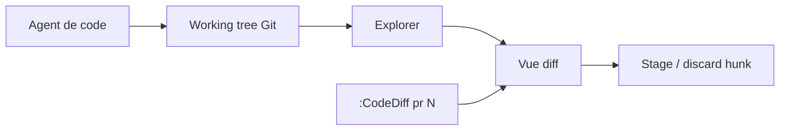

# esmuellert/codediff.nvim

> Plugin Neovim de revue de diffs façon VSCode, pour relire en direct ce que produit un agent de code.

## Le problème
Un agent modifie le dépôt en arrière-plan ; relire ses changements dans Neovim avec les outils diff natifs est pénible.

## Ce que ça fait vraiment
`:CodeDiff` ouvre un explorateur de fichiers modifiés avec diffs côte à côte ou en ligne, au niveau ligne et caractère, rafraîchi au fil des changements. On peut indexer ou rejeter fichiers et hunks, relire des pull requests (GitHub, GitLab, Azure DevOps) sans checkout, parcourir l'historique, comparer fichiers et dossiers, et résoudre des conflits de fusion. Une bibliothèque native est téléchargée au premier usage.

## Comment c'est branché


## Essayer
```bash
:CodeDiff
:CodeDiff main...
:CodeDiff pr 512
:CodeDiff history
git difftool main feature-branch
```
Installation : `{ "esmuellert/codediff.nvim", cmd = "CodeDiff" }` dans lazy.nvim.

## Coût et pièges
Neovim 0.7 minimum (0.10 conseillé), Git, `curl` ou `wget` pour le binaire précompilé. Sans téléchargement possible, compilation C11 à la main.

## Ce que ce n'est pas
Pas un agent ni un outil d'IA : un visualiseur de diffs. Réservé à Neovim.

## Alternatives
Le README ne cite aucune alternative nommée.

## Pour toi
À surveiller si tu travailles sous Neovim avec des agents de code : il règle bien la relecture, sans rien d'autre à adopter.

