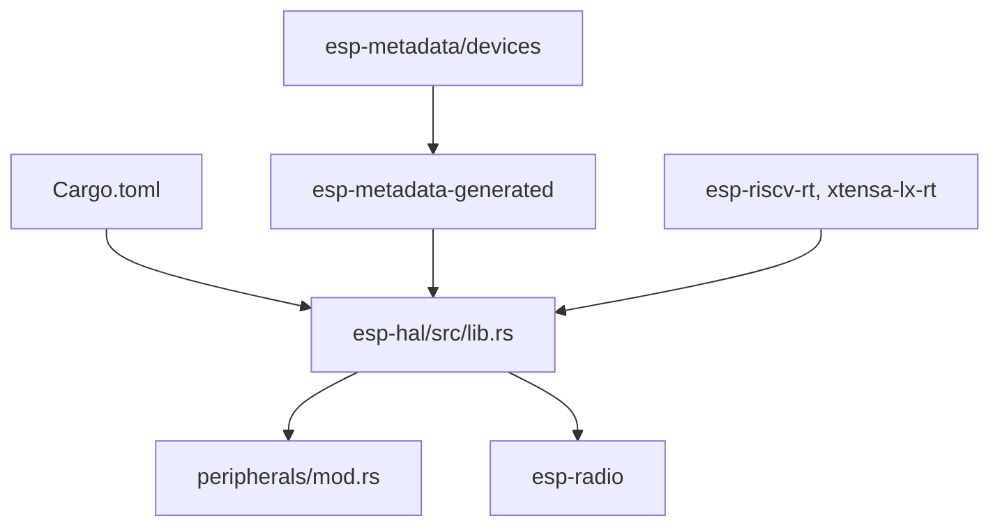

# esp-rs/esp-hal

> Rust no-std hardware abstraction layer for Espressif ESP32 chips, for firmware developers.

## The problem
Programming ESP32s in bare-metal Rust requires typed, safe drivers for each chip family.

## What it actually does
Provides drivers (GPIO, clocks, DMA, timers, communications, storage, cryptography, sleep, multicore) for the ESP32, C, H, P and S families, with companion crates: esp-radio (Wi-Fi, BLE, ESP-NOW, 802.15.4), esp-rtos, esp-alloc, esp-storage, esp-lp-hal for low-power cores. Chip capabilities are described in TOML and generated. Maturity varies by crate.

## How it is wired

## Trying it
No command documented in the README: it points to the "Rust on ESP" book and the documentation.

## Cost and gotchas
Free. Requires the RISC-V and Xtensa Rust toolchains and ESP32 hardware to validate; consult the examples at the release tag, since the main branch moves. A contribution policy governs the use of AI tools.

## What it is not
Not an application framework nor an RTOS by itself (esp-rtos is optional). Not an embedded ML stack.

## Alternatives
esp-idf-svc: an approach based on ESP-IDF, cited in the README's references.

## For you
Ignore unless you have an embedded AI project on ESP32 in Rust: otherwise too low-level for a data/MLOps profile.
