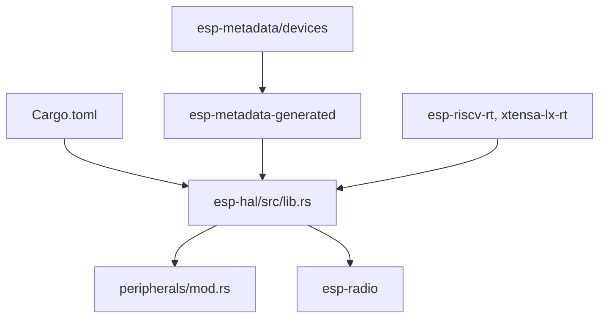

# esp-rs/esp-hal

> Couche d'abstraction matérielle Rust sans std pour les puces Espressif ESP32, pour développeurs de firmware.

## Le problème
Programmer des ESP32 en Rust bare-metal exige des pilotes typés et sûrs pour chaque famille de puces.

## Ce que ça fait vraiment
Fournit des pilotes (GPIO, horloges, DMA, minuteries, communications, stockage, cryptographie, veille, multicœur) pour les familles ESP32, C, H, P et S, avec des crates annexes : esp-radio (Wi-Fi, BLE, ESP-NOW, 802.15.4), esp-rtos, esp-alloc, esp-storage, esp-lp-hal pour les cœurs basse consommation. Les capacités des puces sont décrites en TOML et générées. Maturité variable selon les crates.

## Comment c'est branché

## Essayer
Aucune commande documentée dans le README : il renvoie au livre « Rust on ESP » et à la documentation.

## Coût et pièges
Gratuit. Exige les chaînes Rust RISC-V et Xtensa et du matériel ESP32 pour valider ; consulter les exemples au tag de version, car la branche principale évolue. Une politique de contribution encadre l'usage d'outils d'IA.

## Ce que ce n'est pas
Pas un framework d'application ni un RTOS en soi (esp-rtos est optionnel). Pas une pile ML embarquée.

## Alternatives
esp-idf-svc : approche reposant sur ESP-IDF, citée dans les références du README.

## Pour toi
À ignorer sauf projet d'IA embarquée sur ESP32 en Rust : sinon trop bas niveau pour un profil data/MLOps.

